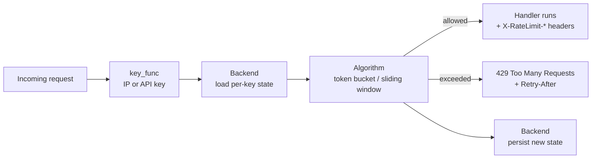

# api-rate-limiter

> A small, dependency-light rate-limiting toolkit for FastAPI — token-bucket and sliding-window algorithms behind a pluggable backend, with proper `429` responses and `X-RateLimit-*` / `Retry-After` headers.


## Overview

`api-rate-limiter` gives a FastAPI app request throttling without pulling in a
cache server or a heavyweight framework. You pick an algorithm (token bucket or
sliding window), pick a backend (in-memory by default), and attach it either as
a per-route dependency or as app-wide middleware. Callers that exceed their
limit get a standards-friendly `429 Too Many Requests` with a `Retry-After`
header telling them exactly how long to wait.

The algorithms are pure and time is injected, so the whole test suite runs
offline and instantly — no `sleep`, no network, no external services.

## Architecture



A request is reduced to a **key**, the **backend** loads that key's counter
state, the **algorithm** decides allow-or-deny (and computes the headers), and
the new state is written back. The FastAPI layer turns that decision into a
response.

## Algorithms

| | Token bucket | Sliding window (log) |
|---|---|---|
| **Model** | Bucket of `capacity` tokens, refills at `refill_rate`/sec | Timestamps of accepted requests over a rolling `window` |
| **Allows bursts?** | Yes, up to `capacity` | No — smooth across the window |
| **Boundary bursts?** | N/A | None (true sliding, not fixed) |
| **Memory per key** | O(1) (two floats) | O(limit) (one timestamp per request) |
| **Best for** | Bursty clients you want to average out over time | Hard "no more than N per window" guarantees |

**Rule of thumb:** use the **token bucket** when occasional bursts are fine as
long as sustained rate stays bounded (most public APIs); use the **sliding
window** when you must never exceed N requests in a period, with no
end-of-window burst loophole.

## Features

- Two algorithms sharing one interface: `TokenBucket` and `SlidingWindow`.
- Pure, clock-injectable algorithm core — deterministic and fast to test.
- Pluggable backend via a `Backend` protocol; `InMemoryBackend` included.
- Documented `RedisBackend` interface for a distributed deployment.
- FastAPI **dependency** (per-route) and **middleware** (app-wide).
- Keys by API key header (`X-API-Key`) or client IP out of the box; bring your own `key_func`.
- Standard `X-RateLimit-Limit` / `X-RateLimit-Remaining` / `X-RateLimit-Reset` headers, plus `Retry-After` on `429`.

## Tech stack

- **Python 3.11+**
- **FastAPI / Starlette** for the web integration
- **stdlib only** for the algorithms (`time.monotonic`, injectable)
- **pytest** + Starlette's `TestClient` for tests

## Getting started

```bash
git clone https://github.com/matthews-wong/api-rate-limiter.git
cd api-rate-limiter

python -m venv .venv
source .venv/bin/activate        # Windows: .venv\Scripts\activate

pip install -e ".[dev]"
pytest                            # fast, offline
```

Run the example app:

```bash
uvicorn examples.app:app --reload
# then: curl -i localhost:8000/ping   (repeat past the limit to see a 429)
```

## Usage

```python
from fastapi import Depends, FastAPI

from ratelimiter import RateLimit, RateLimiter, TokenBucket

app = FastAPI()

# 5 requests of burst, refilling at 1 request/second.
limiter = RateLimiter(TokenBucket(capacity=5, refill_rate=1.0))
guard = RateLimit(limiter)   # keys by API key, else client IP


@app.get("/ping", dependencies=[Depends(guard)])
def ping():
    return {"pong": True}
```

App-wide instead of per-route:

```python
from ratelimiter import RateLimiter, RateLimitMiddleware, SlidingWindow

limiter = RateLimiter(SlidingWindow(limit=100, window_seconds=60))
app.add_middleware(RateLimitMiddleware, limiter=limiter)
```

Example response once the limit is exceeded:

```http
HTTP/1.1 429 Too Many Requests
content-type: application/json
X-RateLimit-Limit: 5
X-RateLimit-Remaining: 0
X-RateLimit-Reset: 5
Retry-After: 1

{"detail": "Rate limit exceeded"}
```

A successful response carries the same `X-RateLimit-*` headers (without
`Retry-After`) so clients can self-throttle before hitting the wall.

## Project structure

```
api-rate-limiter/
├── ratelimiter/
│   ├── __init__.py         # public exports
│   ├── models.py           # state + RateLimitResult (headers)
│   ├── algorithms.py       # TokenBucket, SlidingWindow (pure, clock-injected)
│   ├── backend.py          # Backend protocol, InMemoryBackend, RedisBackend interface
│   ├── limiter.py          # RateLimiter: algorithm + backend
│   ├── keys.py             # key extraction (API key / IP)
│   ├── middleware.py       # app-wide ASGI middleware
│   └── dependency.py       # per-route FastAPI dependency
├── examples/
│   └── app.py              # tiny FastAPI demo
├── tests/
│   ├── conftest.py         # FakeClock fixture (no real sleeps)
│   ├── test_algorithms.py  # refill-over-time + window counting
│   ├── test_concurrency.py # concurrent same-key checks never over-admit
│   └── test_fastapi.py     # TestClient: 200s then 429
├── .github/workflows/ci.yml
├── pyproject.toml
├── requirements.txt
├── LICENSE
└── README.md
```

## Testing

```bash
pytest
```

Time is injected through a `FakeClock`, so tests advance the clock explicitly
(`clock.advance(2.0)`) instead of sleeping. The suite covers token-bucket refill
over time, sliding-window counting and expiry, header/`Retry-After` math, and a
FastAPI `TestClient` flow that returns `200`s up to the limit and `429`s past it,
plus a concurrency suite asserting that many threads hitting the same key never
admit more than the configured limit.

## Roadmap

- **Redis backend** — implement the documented interface with atomic Lua scripts.
- **Distributed limits** — shared counters across app instances via the Redis backend and server-side time.
- **Fixed-window + leaky-bucket** algorithms for completeness.
- **Per-route configuration** helpers and tiered limits by API key.

## License

MIT — see [LICENSE](LICENSE).

---

*Part of my cloud & AI portfolio — see [github.com/matthews-wong](https://github.com/matthews-wong).*
